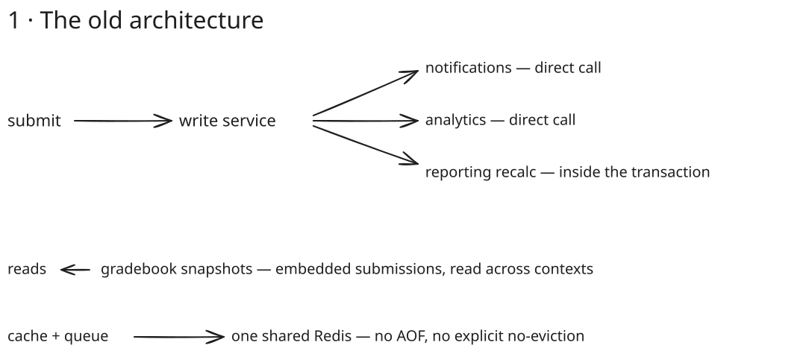
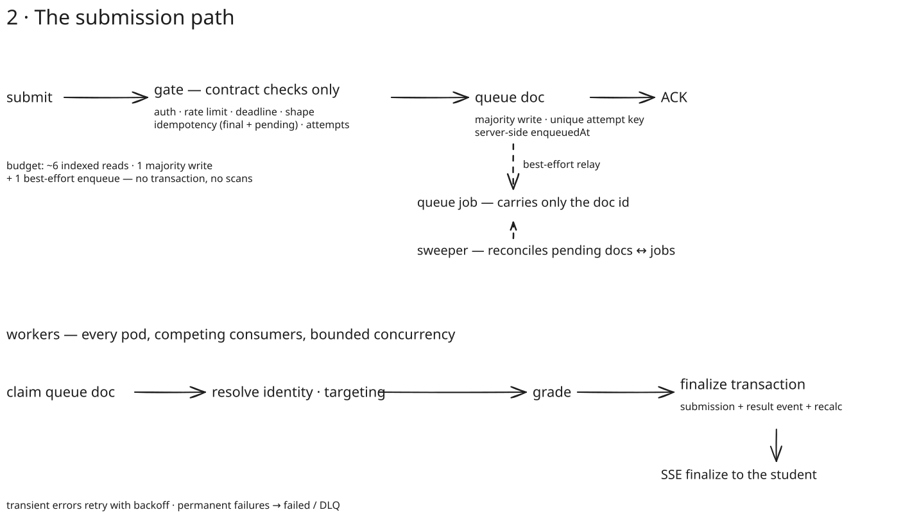
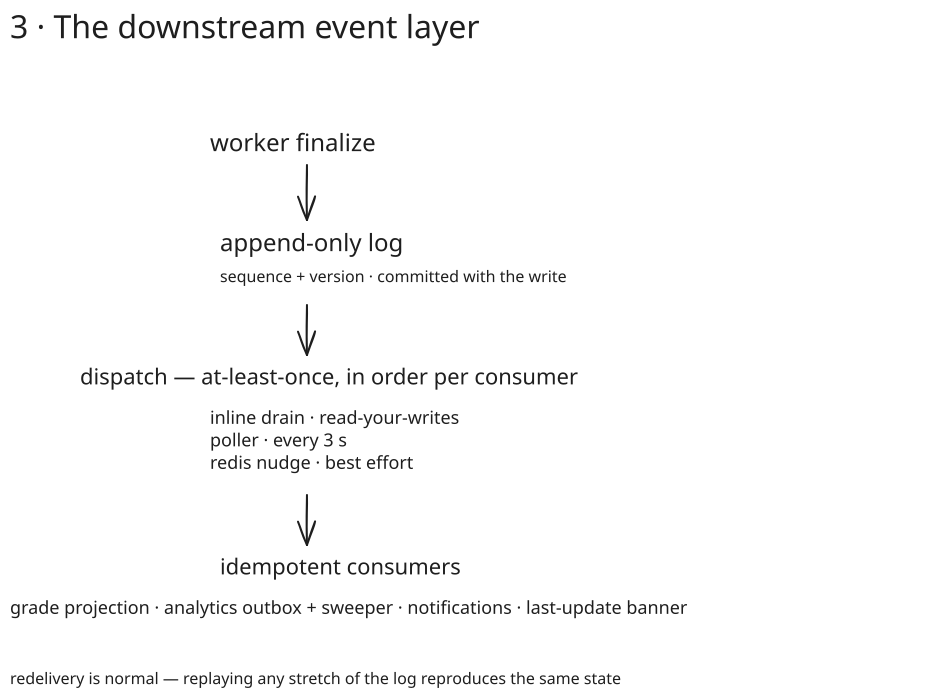

When Sara is taking her exam, the last thing she has on her mind is whether clicking "submit" will actually work.

The exam ends: in the last two minutes of the window, most of the class hits submit at the same time. It's not only the class — these are central exams, everyone in the country is submitting at the same time.

When the system shows "Submitted", this is a promise to Sara that her exam is now safely stored with it and she doesn't need to worry.

## Acknowledgement

The acknowledgement is a promise. How is it implemented? What is the formal and informal literature available for this? These are questions a systems designer or architect has to answer. Jim Gray's ["Queues are Databases"](https://www.microsoft.com/en-us/research/wp-content/uploads/2016/02/tr-95-56.pdf) is a foundational paper. He points out that queues and databases are not different species — a queue _is_ a database albeit with specialized semantics (enqueue, transactional dequeue, visibility, ACK).

**What does an ACK mean in your system?** What guarantees does your system provide around storage of the user's data?

**The dual-write problem** is the big question any distributed system has to answer, and its canonical solution is commonly called a transaction. As Chris Richardson explains it: a database update and a broker publish must be atomic; 2PC is not viable, so you persist the message with the domain write and let a relay publish it.

- [Transactional outbox](https://microservices.io/patterns/data/transactional-outbox.html) (for the atomicity)
- [Polling Publisher](https://microservices.io/patterns/data/polling-publisher.html) + [Transaction Log Tailing](https://microservices.io/patterns/data/transaction-log-tailing.html) (relay implementations)

An ACK must not outrun durability: persist before you externalize. This is write-ahead logging, formalized in **Mohan et al., "ARIES" (ACM TODS 1992)**. The older, more general formulation is in Hohpe & Woolf, _Enterprise Integration Patterns_ (2003), which covers **Guaranteed Delivery**, **Message Store**, **Transactional Client**, and **Idempotent Receiver**.

Two Pat Helland papers frame the distributed-systems theory:

- "Life Beyond Distributed Transactions: An Apostate's Opinion" (CIDR 2007): don't span resources in distributed transactions; use messages plus idempotence.
- "Idempotence Is Not a Medical Condition" (ACM Queue 2012): exactly-once is not achievable as delivery but is achieved as effect.

For us, this means that the submission document and its result event commit in **one database transaction**, and the ACK is that commit. No window of uncertainty exists in this case. In the modern path below, this promise splits in two: the gate's "Submitted" is the durable acceptance write (the queue document), and the worker's finalize transaction — submission document plus result event, atomically — is the ACK for the result itself.

AWS have documented this same pattern for their Lambda service: _Lambda makes sure that your function is run, even in the face of server failures, so it needs a durable queue in which to store your request. With a durable queue, your request can be re-driven if your function fails the first time._ ([AWS Builders' Library](https://builder.aws.com/content/3EuRcgkTP1MI0c7zM8W6HL3WIqA/avoiding-insurmountable-queue-backlogs))

## Legacy Architecture

This is what the legacy architecture looks like (high level):

Everything is inline. At scale, the budget is very tight: we want to save the document coming in as quickly as possible so we can save the next one. Any slowdown downstream ripples up, as can be seen in the picture.

Side effects had no single delivery story and were spread all over the place: sometimes they are direct calls, sometimes enqueued with a poller implemented to drain the outbox. Each context has its own retry semantics, as well as its own failure handling. And its own idea of an event — **there is no shared ledger, no canonical envelope, and no single place to look to answer whether a side effect happened and how many times.**

Reads were coupled similarly: the de-facto shared read model is a snapshot collection whose documents fully embedded their submissions — one of the largest collections in the database, written by several contexts and read through one another's services. No single context owned it and it made it expensive to both change and read.

At scale, this fails: the deadline burst arrives at a request path wired everywhere. The transaction fails if any downstream fails. We have also had cases of partial successes because there's no overarching manager (e.g. a durable execution engine).

## Modern Architecture

### Write Path

Although fairly complex, I have tried to summarize it in the following table. The idea is to get the submission asap into a ledger — one that we can later build upon.

All the expensive work is done by workers. A worker would claim a pending queue document and process it. Details omitted for brevity.

| #       | Operation                                                                                     | Cost                   | Stage             | Where / Why                                      |
| ------- | --------------------------------------------------------------------------------------------- | ---------------------- | ----------------- | ------------------------------------------------ |
| 1, 2    | Sign-in check; per-user rate limit                                                            | Negligible; 1 cache op | Gate              | Guards against runaway clients                   |
| 3       | Assessment `_id` read                                                                         | 1 indexed read         | Gate              | Deadline and format                              |
| 4, 5    | Deadline check; payload shape check                                                           | CPU                    | Gate              | Reject bad input early                           |
| 6, 7, 8 | `attemptKey` detection; compare payloads                                                      | 2 indexed reads + CPU  | Gate              | Duplicates return same status                    |
| 9       | Attempt policy pre-check                                                                      | Up to 3 reads          | Gate              | Immediate rejection                              |
| 10      | `w:majority` · `attemptKey` · `enqueuedAt` — submission durably saved                         | 1 write                | Gate              | Durability barrier                               |
| 11      | `queue.add({ submissionId })` — dispatch job                                                  | 1 cache op             | Gate, best-effort | Sweeper covers failure                           |
| 12, 13  | Receive job and claim it atomically                                                           | 1 write                | Worker            | Single processor; redeliveries become no-ops     |
| 14-19   | Verify the student, targeting, course and question data; re-check attempt policy              | A few reads            | Worker            | Permanent failures surface via status            |
| 20-23   | Grade, then commit submission and result event in one transaction                             | CPU, 3+ writes         | Worker            | The transaction is the ACK for the result        |
| 24-28   | Side effects: gradebook recalc, consumer drain, proctored finish, draft delete, cache cleanup | Variable               | Worker            | Best-effort; never block a submit on a third party |
| 29-31   | Notify and recover: push confirmation, record permanent failures, sweep stuck jobs            | Cheap, bounded         | Worker            | Recovers lost jobs                               |

**Gate total:** ~6 indexed reads + 1 majority write + 1 best-effort Redis op — no transaction, no external calls, no scans, no Person read.

Downstream of the finalize transaction, the result flows through the event layer:

### Infrastructure

The queue is built on Redis. The configuration of Redis is another blog post, but the instance of Redis we're using doesn't support Append Only File (AOF), which can lead to data loss. It is tolerated here because we're persisting first and foremost on the primary data store. Is a queue a good source of truth? We try to answer that next…

## Is a queue a good source of truth?

As established earlier, a queue is a specialized database. So the question is: what is the durability guarantee that this queue makes?

| Medium                                                                       | Can it be the acceptance point?                            | Literature                                                                                                                    |
| ---------------------------------------------------------------------------- | ---------------------------------------------------------- | ----------------------------------------------------------------------------------------------------------------------------- |
| Kafka (replicated log, `acks=all` + `min.insync.replicas`)                   | **Yes** — log-centric architecture treats the log as truth | Jay Kreps, "The Log" (2013); Confluent, "Exactly-once Semantics" (Narkhede, 2017)                                             |
| SQS (managed, durable, at-least-once, DLQ)                                   | **Yes**                                                    | AWS docs; API Gateway → SQS → Lambda is the canonical serverless ingestion pattern                                            |
| Database (majority write) + claim queue (`SKIP LOCKED` / `findOneAndUpdate`) | **Yes**                                                    | Gray; Craig Ringer, "What is SKIP LOCKED for?" (2015) — fine at thousands/s, painful at millions/s                            |
| Redis (without AOF)                                                          | **No** — accelerator only                                  | CAP/durability: async replication has RPO > 0; acked writes can vanish on failover (Brewer 2012; Gilbert & Lynch 2002)        |

BullMQ's production guide — [Going to production](https://docs.bullmq.io/guide/going-to-production):

> _"Since BullMQ is based on Redis, persistence needs to be configured manually... We recommend enabling AOF... `maxmemory-policy` must be `noeviction`. This is the **only** setting that guarantees the correct behavior of the queues."_

While we wait for AOF to become available, I found literature that raised alarm bells: **Sidekiq** has documented job loss on hard failover (unless you are on Pro with `super_fetch`), and **Celery's** Redis visibility-timeout semantics bite in exactly the same way. The synthesis rule is short: **your ACK's durability is the minimum of everything you wrote before acking.**

## Queueing theory: bursts, knees, and backlogs

_This section is more about literature, with the design-specific things towards the end. Much of it was done by AI._

Exam windows are a queueing-theory problem wearing a school uniform.

**Little's Law, L = λW** (John D. C. Little, _Operations Research_, 1961): concurrency equals arrival rate times latency. If service latency spikes 100x, in-flight work spikes 100x — threads, heap, and database sessions become a queue you never designed. It is why we bound consumers rather than "drain as fast as possible", and why a slow downstream doesn't get to inflate the submission request.

**The utilization curve (M/M/1, Kingman's formula; Gross et al., _Fundamentals of Queueing Theory_)**: latency behaves like ≈ 1/(1−ρ) — flat until about 70% utilization, then a knee, then a wall. Every exam window walks toward that knee. This is also why an autoscaler that only reacts to CPU is too blunt for bursts: the queue signals load before the CPU does.

**AWS Builders' Library, "Avoiding insurmountable queue backlogs" (David Yanacek)** — [aws.amazon.com/builders-library/avoiding-insurmountable-queue-backlogs](https://aws.amazon.com/builders-library/avoiding-insurmountable-queue-backlogs/) — is the essential operational text: queues are **bimodal** (a fast mode and a backlog mode); backlog mode is dramatically slower to drain than to fill, so an hour of outage can need ~2x capacity for an hour to recover; backpressure must kick in _before_ the backlog; alarm on **message age**, not just depth; DLQ volume is an availability metric.

**Google SRE Book, "Handling Overload"** ([sre.google/sre-book/handling-overload](https://sre.google/sre-book/handling-overload/)) and **"Addressing Cascading Failures"** (ch. 22) supply the controls: load shedding, criticality tiers, adaptive client-side throttling, and retry budgets (≤3 attempts, ≤10% retry ratio) — with the design goal that a backend keeps serving its provisioned rate while receiving 2–10x excess.

Also worth knowing: **Nichols & Jacobson, "Controlling Queue Delay" (ACM Queue 2012)** — bufferbloat: unbounded buffering trades latency for throughput until the buffer itself collapses. Queues are never free; every unbounded queue is a latency debt. And **Dean & Barroso, "The Tail at Scale" (CACM 2013)** — fan-out amplifies tail latency, which matters when one submit triggers grading, recalc, projections, and notifications.

The exam-specific corollaries:

- The deadline is a self-inflicted load spike. You cannot flatten it (students submit when they submit), so you absorb it: an accept-only gate plus bounded, idempotent consumers.
- Retries are the second self-inflicted spike. A transient failure right at the deadline would otherwise multiply traffic — which is what retry budgets, backoff, and jitter are for.
- Consumer lag is the metric to watch, not queue depth. Depth tells you how much work is queued; age tells you whether students are waiting.
- Per-student concurrency is naturally bounded (one active attempt), so the burst is wide, not deep — thousands of small, independent transactions rather than one hot document.

## Idempotency: how "exactly once" is actually achieved

You cannot deliver a message exactly once; you can only make delivering it twice harmless. **At-least-once delivery + idempotent effects = effectively-once.**

The database arbitrates "first writer wins" with a **unique key** — the per-attempt idempotency key. The gate checks it against both finalized submissions and pending queue documents, and the key stays unique when the worker finalizes. Retried submits and duplicate deliveries land on the same document; the second writer gets a duplicate-key error and is resolved to the stored attempt, not to a failure. The key is derived from natural identity, not generated randomly, so network retries, double-clicks, and tab reloads all converge.

Consumers are idempotent the same way: upserts keyed by the result id, monotonic guards (only a newer change moves the latest state; the earliest creation timestamp is kept with a minimum operation), and changes recorded as a set. Re-running any consumer over any stretch of the log produces the same state.

Queues, notably, cannot do this for you. A queue can deduplicate within its retention window (with the right configuration), but after that, only the system of record can arbitrate a duplicate — which is why queue products document idempotent-consumer patterns (BullMQ ships an "idempotent jobs" page) instead of promising effective exactly-once. The best industry reference is **Stripe's idempotency keys** ("Designing robust and predictable APIs with idempotency", Stripe blog, 2017) — the same contract we implement for exams. Not exactly Stripe's scale (yet).

Streaming-theory equivalents: **MillWheel (Akidau et al., VLDB 2013)** and the **Dataflow model (VLDB 2015)** — dedup via stable IDs.

One practical footnote: make the acceptance check read the same store the ACK promises. An attempt-key lookup served from a cache is not an idempotency guard; it is a cache hit with a database problem behind it.

## Reading path

**One hour:** the [microservices.io transactional outbox page](https://microservices.io/patterns/data/transactional-outbox.html); the [BullMQ production guide](https://docs.bullmq.io/guide/going-to-production); [AWS, "Avoiding insurmountable queue backlogs"](https://aws.amazon.com/builders-library/avoiding-insurmountable-queue-backlogs/); [SRE ch. 21 "Handling Overload"](https://sre.google/sre-book/handling-overload/).

**Half a day:** Richardson, _Microservices Patterns_, ch. 3–4 (IPC and transactional messaging); Hohpe & Woolf, _Enterprise Integration Patterns_ (the four patterns above); Gray's "Queues are Databases".

**Deep/formal:** Helland's two papers; Kreps, "The Log"; Gross et al., _Fundamentals of Queueing Theory_; ARIES; Dean & Barroso, "The Tail at Scale"; Kafka exactly-once semantics; MillWheel.

The short version, if you take one line: **the database is the record, the queue is a relay, and the ACK is only as durable as the least durable thing you wrote before saying it.**

## Conclusion

Before computers, an exam ended with a handover: the student gave the script to the proctor, and from that moment the paper was the institution's responsibility — one script, one record, one result weeks later. Everything this post described is that same handover, rebuilt in machines: the gate is the hand, the queue document is the receipt, the finalized transaction is the script reaching the examiner, and the log is the sealed archive. The medium changed, the failure modes changed, but the product did not: exactly one durable, attributable result per attempt, identical wherever it is read.

The deadline burst may change when the result is produced, never what it is. The exam window is that contract's first stress test; the report card months later is its acceptance test.
