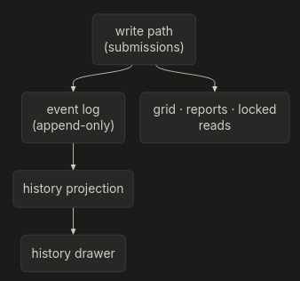

*Retiring snapshot-per-write for an event-fed read model*

**TL;DR**: Shakespeare succinctly describes what will follow but our history storage mechanism was worse than O(N) — we were writing a whole copy of everything at any change. We moved to using events and an event-driven architecture. This is very much appreciated by our DB. Event driven systems are an aggregation of the past — what's past, is prologue! (*The Tempest, ACT II*)

I discuss this topic very briefly here as well (2018 video): [https://youtu.be/-VJ6FtTS8zg](https://youtu.be/-VJ6FtTS8zg)

---

Blended Labs is growing. More schools, more terms, more users.

Growth changes the shape of the problem. A design that behaves acceptably at a few thousand snapshots does not behave acceptably at a few hundred thousand, and the failure mode is rarely an outage — it is a cost curve that bends upward with accumulated history. Writes get slower as the history they append to gets larger; reads get slower as the number of historical copies they must diff grows; storage grows with every edit, not with every entity.

This is the story of removing that curve from the marksheet subsystem.

---

## The naive implementation

The write model was — and still is — a flat table of submissions: one row per `(period, course, class, column, student)` with a value and audit fields. That part is fine.

Alongside every write, the system also stored a **snapshot of the entire class marksheet**.

```text
POST-WRITE SNAPSHOT
┌──────────────────────────────────────────────────────────────┐
│ snapshot                                                     │
│   periodId, courseId, classId                                │
│   action        marksheetUpdate | periodUpdate | recalc | …  │
│   createdBy, createdAt                                       │
│   cells[]       every cell in the class                      │
│   categoryMeta[] per-category column metadata + links        │
│                                                              │
│   unique (periodId, courseId, classId, createdAt DESC)       │
└──────────────────────────────────────────────────────────────┘
```

One teacher changing one mark produced one new document containing the whole class. A recalculation of a term produced one per course, per pass.

The design was not stupid. It bought three things cheaply:

1. **Point-in-time reads.** "Show the marksheet as it was when this was locked" was a single fetch, not a reconstruction.
2. **Decoupling.** Snapshot reads did not depend on the write schema evolving.
3. **Reproducibility.** A generated report could cite the snapshot it was built from.

It worked while the numbers were small. And it was probably fast to implement (though I would contest this fact).

### Where it breaks

```text
write amplification (Big-O notation below)
  one cell change  →  O(class size) bytes written
  one recalc       →  O(courses × class size)

storage growth
  proportional to writes × class size, not to the number of marks

read amplification
  history = load N snapshots, diff them cell by cell
  worst bucket: 862 snapshots, ~43 MB, >2,600 queries

dual truth
  a locked period had live rows AND a copy
  the locked read path read the copy, not the source
```

*\*period-locking is an internal concept we use for proxying data fidelity* — unnecessary for what follows.

## The measured cost

```text
We decided to redact the numbers, but it was in 10s of GBs (not the low 10s either)
```

At the current write rate, the design projected roughly 5x of additional snapshot storage per year, none of which was required to answer either of the two product questions. And this calculation is just based on user growth. Ideally, from a product perspective, we must encourage more people to use more of our features — but this was gonna kill us and our pockets.

---

## Constraints

The migration had to be invisible at the edges:

| Constraint          | Meaning                                               |
| ------------------- | ----------------------------------------------------- |
| Same UI             | no component changes                                  |
| Same GraphQL        | byte-identical schema file **!!**                     |
| Same document bytes | report checksums unchanged                            |
| Same visible data   | opaque ids and transient recalculation state excepted |

---

## Target model

Remove the copy. Keep the write table. Add an append-only log and a projection. Make locked reads read the source.



```text
BEFORE
┌──────────────┐
│  write path  │──► submissions
│              │──► full class copy
└──────────────┘
      │
      ├── grid / reports  ◄── submissions
      ├── history         ◄── load N copies + 3N queries
      └── locked reads    ◄── load copy


AFTER
┌──────────────┐
│  write path  │──► submissions ──► grid / reports / locked reads
│              │──► grade-entry event
└──────────────┘
                        │
                        ▼
                 ┌──────────────┐
                 │  event log   │
                 └──────────────┘
                        │
                        ▼
                 ┌──────────────┐
                 │  projection  │──► history drawer
                 └──────────────┘
```

## What "event-driven" means here

The term is used loosely. In this system it means three concrete things:

1. **State changes are recorded as immutable facts.** A write appends an event describing what changed, carrying a monotonically increasing `sequence`. Facts are never edited in place; corrections arrive as new events.
2. **Read models are derived, not shared.** A consumer reads the log in sequence order and maintains a projection shaped for one question. It keeps its own cursor, so one slow projection does not hold back another, and a new projection is added by replaying from sequence 0.
3. **Delivery is at-least-once, so effects must be idempotent.** A consumer can see the same event twice after a crash or a leader handover. The projection carries a unique key per event, so the second application is a no-op.

Three things this pattern does *not* require — and that we deliberately did not build:

| Commonly assumed                | What this system does                                                          |
| ------------------------------- | ------------------------------------------------------------------------------ |
| Event-sourcing the whole domain | The write table is still the source of truth; events are emitted alongside it  |
| A message broker                | A log in the same database plus an in-process dispatcher; no broker             |
| CQRS across the board           | One projection, for one screen                                                 |

The event is appended **inside the same transaction** as the row it describes, so there is no dual-write window. The dispatcher's poller owns delivery after commit; an inline wake-up is only a latency hint and is allowed to fail without affecting the write.

The price is eventual consistency: a projection may lag the log. That is acceptable only where the screen has a defined staleness budget. Here, the grid, report generation and locked marksheet reads all read current state and never lag; the history drawer may lag by one consumer batch.

---

## Invariants first

Before any code, we wrote down what "correct" meant. Everything after that was a design search constrained by five sentences.

```text
1  every change is observed exactly once                (no gaps)
2  observing it twice has no additional effect          (no duplicates)
3  changes are observed in the order they happened      (no reordering)
4  the derived view can be thrown away and rebuilt      (no lock-in)
5  no screen changes what it shows                      (no visible delta)
```

### Seams

In "Working effectively with Legacy Code", Michael Feathers describes seams, that's what we picked.

The tempting move was to event-source the domain: make events the write model, derive everything from them, and let the submissions table become a projection too. That would have been more elegant and much more expensive — every write path, every migration, every report input, and the entire blast radius of the domain.
We chose a narrower seam:

```text
keep:      the write table, the domain model, the API surface
add:       event emission beside the write
add:       one projection, for one screen
remove:    the snapshot write
change:    locked reads from copy → source
```

### Staleness

Event-driven systems trade consistency for availability, but "eventually consistent" is not a design — it is a question. The question is: which screens are allowed to be behind, and by how much?

```text
grid / marksheet        current-state read        never lags
report generation       current-state read        never lags
locked marksheet        current-state read        never lags
history view            projection                may lag one batch
analytics               projection                may lag one batch
```

Putting the history view on the projection and everything else on current state was the decision that made the migration safe. If the projection is wrong, one screen is wrong. If we had moved the grid onto it, a consumer bug would have been a grading incident.

### We treated the projection as infrastructure

A projection is not a cache. A cache can be dropped and recomputed on demand; a projection is a read path with its own cursor, its own failure modes, and its own recovery procedure. We designed it that way from the start:

```text
- idempotent writes, keyed per source event
- a cursor that advances only after the write succeeds
- a documented rebuild path: truncate, reset cursor, replay
```

That last one matters more than it sounds. The ability to rebuild from the log is what makes the projection a derived artifact rather than a second source of truth.

---

## Execution

The migration was sequenced so that no phase required the previous one to be reversible.

```text
PHASE 1   emit events beside the write
          snapshot still written, projection still empty
          gate: events exist, payloads are complete

PHASE 2   backfill history before the cutoff
          gate: parity against the old copies

PHASE 3   replay events after the cutoff
          gate: cursor reaches the head, no failures

PHASE 4   switch the history read to the projection
          gate: view output matches the diff-based history

PHASE 5   switch locked reads to current state
          gate: locked marksheet identical to the last copy

PHASE 6   stop writing snapshots
          gate: no new documents; old ones frozen, not dropped
```

The snapshot was never deleted. Freezing it is cheap; deleting it removes the rebuild source and the ability to answer historical questions if the projection is ever suspect.

### The backfill had to assume interruption

Two eras meet at a cutoff: before it, copies are the only record; after it, the event log is.

```text
  2024 ────────────────────────── cutoff ───────────────────── today
  │◄────── copies only ─────────►│◄────── event log ─────────►│
                │                            │
                └──────── backfill ──────────┘
                     one pass, restartable
```

We assumed the job would be interrupted — by a deploy, a crash, an operator, or a deadline. So every emitted row carried a deterministic identity derived from the copy, the student and the column. Re-running the job produces the same identities; the storage rejects the ones that already exist. The job is safe to run twice, and safe to stop halfway.

We also knew the traversal order had to be cheap. Walking the copies in the order the history needs them let the database serve the scan from an index instead of sorting twenty gigabytes in memory. That was the difference between a backfill and an outage.

### Cutover without a flag day

There was no moment where we turned the old system off and the new one on. The phases overlapped.

Events were emitted for weeks before anything read the projection. The backfill ran while the old reads were still live. The replay followed the backfill, and the cursor caught up while the old code served the same screens. Reads switched one surface at a time, each behind a parity check.

The only irreversible step was the last one. Once snapshot writes stopped, rolling back the image would have meant old code reading a copy that no longer advanced. We treated that as a one-way door and wrote it down before deploying.

### The token

Locked terms had one more problem: an old report had to be recognisable as stale.

The old system identified a locked term by the copy it was generated against. That identity had to survive the switch, or every existing report would look outdated on day one and the first regeneration would produce a wave of spurious warnings. So we gave each locked term a generation counter, seeded it at one for every term already locked, and made the new identity a pair of the term and its generation. Old reports kept a token that no longer matched the new format, but nothing compared it for correctness — only for equality when deciding whether to warn. The wave never happened.

---

## The night it ran

```text
18:05   backfill starts, in the first pod of the new rollout
19:14   the last snapshot is ever written
19:50   the backfill and the generation stamp both commit
20:51   the replay reaches the head
```

It was a nerve wracking time for me at least. I sat there, watching migrations apply and the cursor move.

---

## Outcome

```text
history view       1 indexed range read (was: up to 862 copy loads)
recalculation      no copy write per course per pass
locked reads       one query, same data as the copy
copy growth        stopped (~41 GB/year avoided)
API surface        unchanged
report checksums   unchanged
```

The generalisable point is not "event sourcing". It is narrower:

> A projection is a read model with a correctness story of its own: a monotonic cursor, an idempotent write key, a rebuild path, and a defined staleness budget. Treat it as production infrastructure, not as a derived table.

The snapshot was never wrong. It was a write-path materialisation of a read-path question, and we paid for it on both sides. (Thanks to AI for this convoluted sentence)

---

## References

- Martin Fowler, [Event Sourcing](https://martinfowler.com/eaaDev/EventSourcing.html), 2005.
- Martin Fowler, [What do you mean by "Event-Driven"?](https://martinfowler.com/articles/201701-event-driven.html), 2017.
- Chris Richardson, [Event-driven architecture pattern](https://microservices.io/patterns/data/event-driven-architecture.html).
- Chris Richardson, [Transactional outbox pattern](https://microservices.io/patterns/data/transactional-outbox.html).
- Microsoft Azure Architecture Center, [Event Sourcing pattern](https://learn.microsoft.com/en-us/azure/architecture/patterns/event-sourcing).
- Martin Kleppmann, *Designing Data-Intensive Applications*, Ch. 11 ("Stream Processing"), O'Reilly, 2017. [dataintensive.net](http://dataintensive.net)
- Pat Helland, [Immutability Changes Everything](https://dl.acm.org/detail.cfm?id=2884038), ACM Queue 13(9), 2015.
- Vaughn Vernon, *Implementing Domain-Driven Design*, Ch. 8 ("Domain Events"), Addison-Wesley, 2013.
- Greg Young, [Versioning in an Event Sourced System](https://leanpub.com/esversioning), Leanpub, 2017.

ME: [https://youtu.be/-VJ6FtTS8zg](https://youtu.be/-VJ6FtTS8zg)
